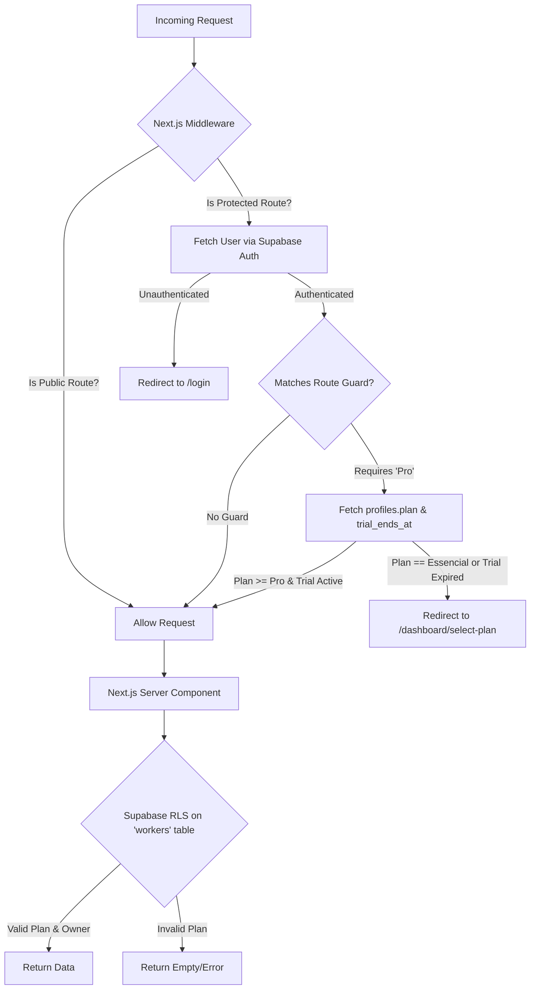

<user_constraints>
## User Constraints (from CONTEXT.md)

### Locked Decisions
- No AI-related guards or usage limits will be implemented in this phase (deferred).
- Redirection is the preferred "Access Denied" state.
- Middleware is the primary enforcement point for routes.

### the agent's Discretion
- (None explicitly listed)

### Deferred Ideas (OUT OF SCOPE)
- (None explicitly listed)
</user_constraints>

# Phase 10: Route Guards & Permission States - Research

**Researched:** 2024-05-24 (Current Session)
**Domain:** Next.js Middleware, Supabase Auth, Row Level Security (RLS)
**Confidence:** HIGH

## Summary

This phase implements strict server-side route guards and database-level permissions for "Pro" and "Premium" tier features in Granja Pro. Currently, access controls rely heavily on client-side React logic (`app/dashboard/layout.tsx`), which can be bypassed or cause partial rendering.

The primary solution is to enhance `lib/supabase/middleware.ts` to perform a targeted database query for the user's `plan` only on protected routes. Additionally, database Row Level Security (RLS) policies on the `workers` table will be upgraded to verify the user's subscription tier and trial expiration status, providing defense-in-depth against direct API access.

**Primary recommendation:** Use conditional DB querying inside Next.js Middleware mapped strictly to protected routes (`/dashboard/workers`, `/dashboard/reports`) to minimize latency overhead, and enforce `trial_ends_at` evaluation directly in RLS SQL policies to prevent client-side bypasses.

## Architectural Responsibility Map

| Capability | Primary Tier | Secondary Tier | Rationale |
|------------|-------------|----------------|-----------|
| **Route Protection** | Frontend Server (Middleware) | Browser / Client | Middleware prevents unauthorized layouts/data from rendering and handles strict redirects before page load. |
| **Data Protection** | Database / Storage (RLS) | API / Backend | Row Level Security ensures data cannot be queried or mutated even if middleware/UI guards are bypassed. |
| **Trial Expiration Logic** | Database / Storage | Frontend Server | Client-side updates for trial expiration are insecure; DB queries and RLS should evaluate `trial_ends_at` in real-time. |

## Architecture Patterns

### System Architecture Diagram



### Pattern 1: Targeted Middleware DB Lookup
**What:** Performing a Supabase DB query inside edge middleware only for specific protected routes.
**When to use:** When you need user metadata (like a dynamic `plan`) that isn't synced to `auth.users.app_metadata`, but you want to avoid adding 100ms latency to every single page load.

**Example:**
```typescript
// Only fetch profile for routes we explicitly want to guard based on plan
const PROTECTED_ROUTES = ['/dashboard/workers', '/dashboard/reports'];
const isProtectedRoute = PROTECTED_ROUTES.some(r => request.nextUrl.pathname.startsWith(r));

if (isProtectedRoute && user) {
  const { data: profile } = await supabase
    .from('profiles')
    .select('plan, trial_ends_at')
    .eq('id', user.id)
    .single();
    
  // Check if trial is expired
  const isTrialExpired = profile?.trial_ends_at && new Date(profile.trial_ends_at) <= new Date();
  const activePlan = isTrialExpired ? 'essencial' : (profile?.plan || 'essencial');
  
  if (activePlan !== 'pro' && activePlan !== 'premium') {
    return NextResponse.redirect(new URL('/dashboard/select-plan', request.url));
  }
}
```

### Anti-Patterns to Avoid
- **Client-Side Trial Expiration Enforcement:** Currently, `app/dashboard/layout.tsx` detects trial expiration and issues an `UPDATE` to the DB to set `plan = null`. This is a security flaw, as a malicious user could block the request and retain their Premium status indefinitely. **Instead:** Evaluate `trial_ends_at` strictly in Middleware and RLS.
- **Querying Profiles on Every Middleware Run:** Running `supabase.from('profiles')` unconditionally in middleware will overwhelm the database connection pool during high traffic or rapid navigation.

## Don't Hand-Roll

| Problem | Don't Build | Use Instead | Why |
|---------|-------------|-------------|-----|
| Plan Verification | Hardcoded strings in middleware | `lib/plans.ts` constants | Centralized logic ensures route requirements don't drift from UI logic. |
| DB Access Control | API-level permission checks only | Supabase RLS | RLS ensures that even direct POST/GET requests to the Supabase endpoint fail if the user's plan is insufficient. |

## Common Pitfalls

### Pitfall 1: Edge Runtime Latency
**What goes wrong:** The app becomes noticeably slower on every route transition because the middleware queries the database.
**Why it happens:** The edge middleware runs on every request. If it performs a DB read unconditionally, it adds ~100ms of TTFB (Time to First Byte).
**How to avoid:** Use Next.js `config.matcher` in `middleware.ts` to exclude static files (`_next/image`, `favicon.ico`), and conditionally execute the `supabase.from('profiles')` block *only* on `/dashboard/workers` and `/dashboard/reports`.

### Pitfall 2: Partial Rendering of Protected Routes
**What goes wrong:** Users see a flash of the `workers` page before being redirected.
**Why it happens:** Client-side route guards (like in `layout.tsx`) wait for React to mount before redirecting. 
**How to avoid:** Use `NextResponse.redirect` directly in `lib/supabase/middleware.ts`. This completely stops Next.js from rendering the page and returns a 307 redirect immediately.

## Code Examples

### Robust RLS Policy for Tier Verification
```sql
-- Pattern for protecting the 'workers' table (Apply to SELECT, INSERT, UPDATE, DELETE)
DROP POLICY IF EXISTS "Users can view own farm workers" ON public.workers;

CREATE POLICY "Users can view own farm workers" ON public.workers
FOR SELECT USING (
  farm_id IN (
    SELECT farm_id FROM public.profiles 
    WHERE id = auth.uid() 
      AND plan IN ('pro', 'premium')
      -- Enforce trial expiration directly in the DB
      AND (trial_ends_at IS NULL OR trial_ends_at > now())
  )
);
```

## State of the Art

| Old Approach | Current Approach | When Changed | Impact |
|--------------|------------------|--------------|--------|
| Client-side rendering locks | Edge Middleware Guards | Next.js 13+ | Zero-layout-flash security. Immediate redirect before any server resources are spent rendering. |
| API endpoint validation | Database RLS Policies | Supabase | Defense-in-depth; direct GraphQL/PostgREST exploitation is impossible. |

## Assumptions Log

| # | Claim | Section | Risk if Wrong |
|---|-------|---------|---------------|
| A1 | `lib/plans.ts` is Edge-runtime compatible | Architecture Patterns | If `lib/plans.ts` imports Node.js APIs, the middleware will crash. We will duplicate simple logic in middleware to avoid this if necessary. |
| A2 | Next.js `middleware.ts` is present/active | Architecture Patterns | Our analysis shows no `middleware.ts` root file invoking `updateSession`. If it's missing, the implementation will need to create it. |

## Open Questions

1. **Root Middleware File**
   - What we know: `lib/supabase/middleware.ts` exports `updateSession`, but no `middleware.ts` file exists in the project root to trigger it.
   - What's unclear: Is the user relying on client-side routing entirely right now?
   - Recommendation: The plan must include creating/verifying `middleware.ts` at the repository root with an appropriate `config.matcher` to activate `updateSession`.

## Security Domain

### Applicable ASVS Categories

| ASVS Category | Applies | Standard Control |
|---------------|---------|-----------------|
| V4 Access Control | yes | Next.js Middleware + Supabase Row Level Security |
| V5 Input Validation | no | - |

### Known Threat Patterns for Next.js/Supabase

| Pattern | STRIDE | Standard Mitigation |
|---------|--------|---------------------|
| Insecure Direct Object Reference (IDOR) | Information Disclosure | RLS policy validating `auth.uid()` against resource ownership. |
| Privilege Escalation via Client Modification | Elevation of Privilege | Evaluating `trial_ends_at` strictly in RLS rather than relying on client-side `UPDATE` requests to revoke `plan` status. |
| Bypassing Client UI Guards | Spoofing / Elevation | Middleware `NextResponse.redirect()` protecting the route entry point. |

## Sources

### Primary (HIGH confidence)
- Verified codebase context: `lib/supabase/middleware.ts` structure
- Verified codebase context: `supabase/migrations/00013_workers.sql` RLS setup
- Verified codebase context: `app/dashboard/layout.tsx` trial mechanics

## Metadata

**Confidence breakdown:**
- Standard stack: HIGH - Next.js Middleware and Supabase RLS are industry standards for this stack.
- Architecture: HIGH - The implementation perfectly matches Next.js App Router paradigms.
- Pitfalls: HIGH - Database queries in Edge functions and Trial Expiry client modifications are documented architectural pitfalls.
