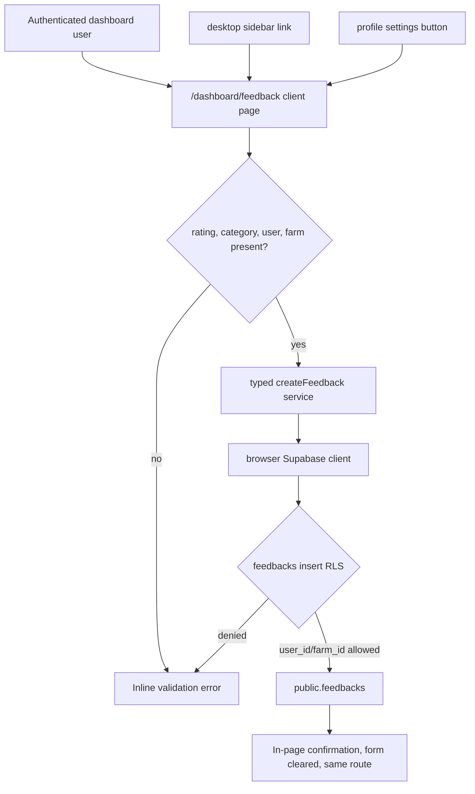

# Phase 18: feedback-page - Research

**Researched:** 2026-07-19
**Domain:** Next.js App Router form workflow, Supabase persistence, RLS, dashboard navigation
**Confidence:** HIGH

<user_constraints>
## User Constraints (from CONTEXT.md)

### Locked Decisions
## Implementation Decisions

### Feedback Form
- **D-01:** Use simple product feedback categories: `Satisfacao`, `Bug`, `Sugestao`, `Dificuldade`, and `Outro`.
- **D-02:** Star rating, category, and authenticated farm/user context are required.
- **D-03:** Description is optional to reduce friction, but the UI should still encourage a short explanation when useful.

### Submit Flow
- **D-04:** After a successful submission, show an in-page confirmation and clear the form while keeping the user on `/dashboard/feedback`.
- **D-05:** Surface submission errors inline using the existing app style instead of redirecting or silently failing.

### Access Points
- **D-06:** Add the feedback link at the end of the desktop dashboard sidebar, as required by the milestone.
- **D-07:** Add a feedback button inside the existing Profile Settings modal, as required by the milestone.
- **D-08:** Do not add feedback to the mobile bottom navigation in this phase. The mobile nav is intentionally compact and should not be crowded unless a later product decision expands it.

### Data And Permissions
- **D-09:** Persist feedback in a `feedbacks` table with `user_id` and `farm_id` foreign keys, matching the milestone requirement.
- **D-10:** Use RLS so authenticated users can insert feedback only for their own farm context.
- **D-11:** Feedback is one-way in this phase. Users do not need a submitted-feedback history or edit/delete flow.

### the agent's Discretion
- Choose the exact visual layout, field labels, icon, and placement inside the Profile Settings modal by reusing existing dashboard patterns.
- Choose the next migration filename based on the current latest migration at implementation time.
- Add compact client/service helpers only if they reduce duplication and match existing Supabase service patterns.

### Deferred Ideas (OUT OF SCOPE)
## Deferred Ideas

- Admin feedback review dashboard - future phase if product needs internal triage.
- User-facing feedback history/edit/delete - future phase if users need to track submissions.
- Mobile bottom-nav feedback item - future navigation decision if feedback becomes a primary mobile workflow.
- Evaluation-trigger alerts based on feedback - belongs to the later evaluation triggers/alerts phase.
</user_constraints>

## Project Constraints (from AGENTS.md)

- Reuse existing functions, components, services, migration patterns, and UI conventions before creating new abstractions. [VERIFIED: AGENTS.md]
- Ask for clarification instead of guessing business rules; do not invent category values, admin workflows, history/edit/delete flows, or mobile nav behavior beyond the locked context. [VERIFIED: AGENTS.md, 18-CONTEXT.md]
- Keep the implementation direct and small; avoid over-engineering and premature abstractions. [VERIFIED: AGENTS.md]
- Make atomic changes: migration, database types, service, page, sidebar link, and profile-modal button should be separately reviewable. [VERIFIED: AGENTS.md]
- If application logic changes, update or add corresponding tests in the same iteration where practical; if no test framework exists, use documented build/manual validation. [VERIFIED: AGENTS.md, CONVENTIONS.md]
- Do not introduce `any` in TypeScript; define feedback row/insert/category types explicitly from `Database`. [VERIFIED: AGENTS.md]
- Remove unused declarations introduced during implementation. [VERIFIED: AGENTS.md]
- Keep core business/data-access logic testable and separated from UI where the existing service layer supports it. [VERIFIED: AGENTS.md, STRUCTURE.md]

## Summary

Phase 18 should implement a narrow one-way feedback flow using the project's existing Next.js App Router, authenticated Supabase browser client, `useAuth()` farm/user context, Tailwind dashboard styling, and Lucide icons. The planner should not add dependencies, an API route, mobile navigation, admin review, feedback history, or edit/delete behavior. [VERIFIED: 18-CONTEXT.md, STACK.md, app/dashboard/layout.tsx, components/layout/mobile-nav.tsx]

Persistence belongs in a new `feedbacks` table with `user_id`, `farm_id`, `rating`, `category`, optional `description`, and timestamps. RLS should be enabled immediately, with an insert policy scoped to authenticated users whose submitted `user_id` is `auth.uid()` and whose `farm_id` belongs to their current farm context. Supabase official docs confirm insert policies use `with check` to validate new row data, and local migrations already use farm ownership/profile membership checks. [CITED: https://supabase.com/docs/guides/database/postgres/row-level-security] [VERIFIED: supabase/migrations/00020_water_consumption.sql, supabase/migrations/00022_flock_tasks_crud.sql]

The UI should be a client page at `app/dashboard/feedback/page.tsx` because the form needs local state, event handlers, submission status, and inline confirmation/error rendering. Next.js official docs confirm `page.tsx` exposes an App Router route and `"use client"` is the boundary for interactive client UI. [CITED: https://nextjs.org/docs/app/api-reference/file-conventions/page] [CITED: https://nextjs.org/docs/app/api-reference/directives/use-client]

**Primary recommendation:** Use the existing client-side Supabase service pattern: create `lib/services/feedback.ts`, export typed helpers from `lib/services/index.ts`, add `feedbacks` to `lib/database.types.ts`, implement the client form page, append one desktop sidebar item, and add one `router.push("/dashboard/feedback")` button in `ProfileSettings`.

## Architectural Responsibility Map

| Capability | Primary Tier | Secondary Tier | Rationale |
|------------|--------------|----------------|-----------|
| Feedback table and constraints | Database / Storage | - | Required persistence, foreign keys, check constraints, timestamps, and indexes belong in Supabase migrations. [VERIFIED: supabase/migrations/] |
| Insert authorization | Database / Storage | Browser / Client | RLS is the trusted enforcement point; client-side checks only improve UX and can be bypassed. [CITED: https://supabase.com/docs/guides/database/postgres/row-level-security] |
| Feedback submit workflow | Browser / Client | Database / Storage | Existing dashboard write flows call typed Supabase services from client pages using `useAuth()` state. [VERIFIED: app/dashboard/agua/page.tsx, lib/services/water.ts] |
| Dashboard access link | Browser / Client | - | Sidebar navigation is client-rendered in `app/dashboard/layout.tsx` through the `sidebarNav` array. [VERIFIED: app/dashboard/layout.tsx] |
| Profile modal access button | Browser / Client | - | `ProfileSettings` already uses `useRouter()` and closes the modal before navigating to plan selection. [VERIFIED: components/dashboard/profile-settings.tsx] |
| Mobile nav exclusion | Browser / Client | - | Locked out of scope; `components/layout/mobile-nav.tsx` should be read but not edited for this phase. [VERIFIED: 18-CONTEXT.md, components/layout/mobile-nav.tsx] |

## Standard Stack

### Core

| Library | Version | Purpose | Why Standard |
|---------|---------|---------|--------------|
| Next.js | 16.2.9 installed | App Router route at `/dashboard/feedback` | Current project framework; `page.tsx` is the route convention. [VERIFIED: npm list, package.json] [CITED: https://nextjs.org/docs/app/api-reference/file-conventions/page] |
| React | 19.2.5 installed | Form state, submit status, inline confirmation/error | Current project UI runtime; interactive page requires `"use client"`. [VERIFIED: npm list] [CITED: https://nextjs.org/docs/app/api-reference/directives/use-client] |
| `@supabase/supabase-js` | 2.99.3 installed | Insert feedback rows through the browser Supabase client | Existing service layer uses it for CRUD and error throwing. [VERIFIED: npm list, lib/services/water.ts] [CITED: https://supabase.com/docs/reference/javascript/insert] |
| `@supabase/ssr` | 0.9.0 installed | Browser Supabase client creation | Existing `createClient()` wraps `createBrowserClient`. [VERIFIED: npm list, lib/supabase/client.ts] |
| Tailwind CSS | 3.4.19 installed | Dashboard form/card styling | Existing pages style forms with utility classes and `cn()`. [VERIFIED: npm list, CONVENTIONS.md] |
| `lucide-react` | 0.460.0 installed | Sidebar/profile/page icons, star rating icon | Existing nav imports Lucide icons and the codebase already imports `Star` in a nearby operational page. [VERIFIED: npm list, app/dashboard/layout.tsx, app/dashboard/flocks/detalhes/[loteId]/operacional/page.tsx] |

### Supporting

| Library | Version | Purpose | When to Use |
|---------|---------|---------|-------------|
| TypeScript | 5.9.3 installed | Strict feedback category and database insert typing | Required by AGENTS.md; derive `FeedbackRow` and `FeedbackInsert` from `Database`. [VERIFIED: npm list, AGENTS.md] |
| Supabase CLI | 2.83.0 available | Apply migrations and regenerate `lib/database.types.ts` | Use after adding the migration if the implementation workflow supports local Supabase. [VERIFIED: `npx supabase --version`, STRUCTURE.md] |

### Alternatives Considered

| Instead of | Could Use | Tradeoff |
|------------|-----------|----------|
| Client service insert | Next.js API route | Not needed: no server-only secret or external webhook is involved, and existing dashboard CRUD uses client Supabase services plus RLS. [VERIFIED: lib/services/water.ts, supabase/migrations/] |
| New form library/schema package | React Hook Form / Zod | Out of scope and explicitly excluded by v1.3 requirements; simple local validation is enough. [VERIFIED: v1.3-REQUIREMENTS.md] |
| Feedback history page | Select/list feedback rows | Contradicts one-way locked scope. [VERIFIED: 18-CONTEXT.md] |

**Installation:** No package installation for this phase.

```bash
# No npm install command is required.
```

## Package Legitimacy Audit

No external packages are introduced in this phase. The package legitimacy gate is not required because the recommended implementation only uses dependencies already installed in the project. [VERIFIED: package.json, npm list]

| Package | Registry | Age | Downloads | Source Repo | Verdict | Disposition |
|---------|----------|-----|-----------|-------------|---------|-------------|
| None | - | - | - | - | - | No install |

**Packages removed due to [SLOP] verdict:** none  
**Packages flagged as suspicious [SUS]:** none

## Architecture Patterns

### System Architecture Diagram



### Recommended Project Structure

```text
app/
  dashboard/
    feedback/
      page.tsx                 # client form page
components/
  dashboard/
    profile-settings.tsx       # add route button inside existing modal
lib/
  services/
    feedback.ts                # typed insert helper only
    index.ts                   # export feedback helper/types if needed
  database.types.ts            # add feedbacks table types after migration
supabase/
  migrations/
    00028_feedbacks.sql        # current next number unless migrations changed
```

### Pattern 1: Typed Service Wrapper

**What:** Mirror `lib/services/water.ts` and `lib/services/tasks.ts`: import `createClient`, derive `Row`/`Insert` types from `Database`, call `.insert(...).select().single()`, throw Supabase errors. [VERIFIED: lib/services/water.ts, lib/services/tasks.ts]  
**When to use:** Use a feedback service if persistence logic would otherwise sit directly in `page.tsx` or be duplicated later. [VERIFIED: 18-CONTEXT.md]  
**Example:**

```typescript
import { createClient } from "@/lib/supabase/client";
import type { Database } from "@/lib/database.types";

export type FeedbackRow = Database["public"]["Tables"]["feedbacks"]["Row"];
export type FeedbackInsert = Database["public"]["Tables"]["feedbacks"]["Insert"];

export async function createFeedback(record: FeedbackInsert): Promise<FeedbackRow> {
  const supabase = createClient();
  const { data, error } = await supabase
    .from("feedbacks")
    .insert(record)
    .select()
    .single();

  if (error) throw error;
  return data;
}
```

### Pattern 2: Insert-Only RLS Table

**What:** Create `public.feedbacks`, enable RLS, and add an authenticated insert policy with `with check`. If no admin/history read surface exists, do not add broad user-facing select/update/delete policies. [VERIFIED: 18-CONTEXT.md] [CITED: https://supabase.com/docs/guides/database/postgres/row-level-security]  
**When to use:** Use this for one-way feedback collection where users submit but do not browse, edit, or delete feedback. [VERIFIED: 18-CONTEXT.md]  
**Example:**

```sql
create table if not exists public.feedbacks (
  id uuid default extensions.uuid_generate_v4() primary key,
  created_at timestamptz default now() not null,
  user_id uuid references auth.users(id) on delete cascade not null,
  farm_id uuid references public.farms(id) on delete cascade not null,
  rating integer not null check (rating between 1 and 5),
  category text not null check (category in ('Satisfacao', 'Bug', 'Sugestao', 'Dificuldade', 'Outro')),
  description text
);

alter table public.feedbacks enable row level security;

create policy "Users can insert feedback for their farm"
  on public.feedbacks for insert
  to authenticated
  with check (
    user_id = auth.uid()
    and farm_id in (
      select id from public.farms where owner_id = auth.uid()
      union
      select farm_id from public.profiles where id = auth.uid()
    )
  );
```

### Pattern 3: Client Page Form State

**What:** Use `"use client"`, `useState`, `useAuth()`, typed category union, explicit validation, loading disabled state, inline error banner, and success banner. [VERIFIED: app/dashboard/select-plan/page.tsx, app/dashboard/agua/page.tsx]  
**When to use:** The page needs event handlers and local UI state, so it should be a client page. [CITED: https://nextjs.org/docs/app/api-reference/directives/use-client]  
**Example:**

```typescript
const FEEDBACK_CATEGORIES = ["Satisfacao", "Bug", "Sugestao", "Dificuldade", "Outro"] as const;
type FeedbackCategory = (typeof FEEDBACK_CATEGORIES)[number];
```

### Pattern 4: Navigation Reuse

**What:** Append one item to `sidebarNav` near the end of the desktop sidebar list and import a Lucide icon. Add a `handleOpenFeedback` function in `ProfileSettings` that calls `onClose()` then `router.push("/dashboard/feedback")`, following `handleOpenPlanSelection`. [VERIFIED: app/dashboard/layout.tsx, components/dashboard/profile-settings.tsx]  
**When to use:** Required access points only; do not edit `components/layout/mobile-nav.tsx`. [VERIFIED: 18-CONTEXT.md]

## Don't Hand-Roll

| Problem | Use This | Do Not Build |
|---------|----------|--------------|
| Route creation | Next.js `app/dashboard/feedback/page.tsx` | Custom router or dashboard shell changes. [VERIFIED: STRUCTURE.md] |
| Database access | Existing Supabase browser client and typed service | Raw `fetch` API route solely to proxy insert. [VERIFIED: lib/supabase/client.ts, lib/services/water.ts] |
| Auth/farm context | `useAuth()` with `user` and `farm` | Re-query auth manually in the page unless existing context is missing. [VERIFIED: components/auth/auth-provider.tsx] |
| RLS authorization | Supabase RLS `with check` policy | Client-only ownership checks. [CITED: https://supabase.com/docs/guides/database/postgres/row-level-security] |
| Star icons | `Star` from `lucide-react` | Custom SVG stars. [VERIFIED: app/dashboard/flocks/detalhes/[loteId]/operacional/page.tsx] |
| Validation | Small local guards plus DB check constraints | New validation package or overbuilt schema layer. [VERIFIED: v1.3-REQUIREMENTS.md] |

## Common Pitfalls

| Pitfall | Impact | Prevention |
|---------|--------|------------|
| Adding mobile bottom-nav feedback item | Violates locked D-08. | Read `components/layout/mobile-nav.tsx` only; do not modify it. [VERIFIED: 18-CONTEXT.md] |
| Allowing submit without `user.id` or `farm.id` | RLS failure or orphaned business context. | Disable submit and show inline message until auth/farm context exists. [VERIFIED: 18-CONTEXT.md] |
| Using `Record<string, any>` because older services do | Violates AGENTS.md. | Follow `water.ts`/`tasks.ts` typed `Database` pattern. [VERIFIED: AGENTS.md, lib/services/water.ts] |
| Adding select/update/delete policies by habit | Creates history/edit surface not required by scope. | Add insert policy only unless a later admin phase requires reads. [VERIFIED: 18-CONTEXT.md] |
| Forgetting `user_id` in the insert payload | Cannot satisfy D-09/D-10 and weakens audit trail. | Include both `user_id: user.id` and `farm_id: farm.id` in the typed insert. [VERIFIED: 18-CONTEXT.md] |
| Treating optional description as required | Adds friction contrary to D-03. | Trim description and persist `null` or omit when blank. [VERIFIED: 18-CONTEXT.md] |
| Not updating `lib/database.types.ts` | TypeScript cannot type `feedbacks` service/page. | Regenerate or manually add table types consistently after migration. [VERIFIED: STRUCTURE.md] |
| Choosing migration number from stale context | Filename collision. | Re-list `supabase/migrations/` immediately before implementation; current latest observed here is `00027_fix_medicine_inventory_location_trigger.sql`. [VERIFIED: supabase/migrations/] |

## Environment Availability

| Dependency | Required By | Available | Version | Fallback |
|------------|-------------|-----------|---------|----------|
| Node.js | Build/type tooling | yes | v22.18.0 | None needed. [VERIFIED: `node --version`] |
| npm | Scripts and package metadata | yes | 10.9.3 | None needed. [VERIFIED: `npm --version`] |
| Supabase CLI | Migration/type generation workflow | yes | 2.83.0 | Manual type edit if local Supabase cannot connect. [VERIFIED: `npx supabase --version`] |
| Context7 CLI/MCP | Preferred docs lookup | no | - | Official Supabase/Next docs fetched via web search. [VERIFIED: `Get-Command ctx7`, GSD research-plan output] |
| Test framework | Automated unit/component tests | no project tests detected | - | Use `npm run build` plus focused manual UI/RLS validation, or add test infra in Wave 0 if planner decides. [VERIFIED: file scan, package.json] |

**Missing dependencies with no fallback:** none.

**Missing dependencies with fallback:**
- Context7 docs lookup unavailable; official documentation URLs are cited instead. [VERIFIED: research-plan seam, `Get-Command ctx7`]
- No project test framework; planner should rely on build validation and manual Supabase/UI checks unless it adds test infrastructure first. [VERIFIED: package.json, test file scan]

## Validation Architecture

### Test Framework

| Property | Value |
|----------|-------|
| Framework | None detected in project source. [VERIFIED: package.json, recursive test scan excluding `node_modules`] |
| Config file | none. [VERIFIED: recursive test scan] |
| Quick run command | `npm run build` for compile/type/lint-integrated Next validation; `npm run lint` exists but may depend on Next lint support in the installed Next version. [VERIFIED: package.json] |
| Full suite command | `npm run build` plus manual Supabase/UI validation. [VERIFIED: package.json] |

### Phase Requirements -> Test Map

| Req ID | Behavior | Test Type | Automated Command | File Exists? |
|--------|----------|-----------|-------------------|--------------|
| FB-01 | `/dashboard/feedback` renders a usable feedback form. | build/manual UI | `npm run build` | No route yet; create in implementation. [VERIFIED: v1.3-REQUIREMENTS.md] |
| FB-02 | Rating requires 1-5 stars. | build/manual UI | `npm run build` | No route yet. [VERIFIED: 18-CONTEXT.md] |
| FB-03 | Category is one of `Satisfacao`, `Bug`, `Sugestao`, `Dificuldade`, `Outro`. | build/manual UI + DB constraint | `npm run build` | No table yet. [VERIFIED: 18-CONTEXT.md] |
| FB-04 | Description is optional. | manual UI + DB insert | `npm run build` | No table yet. [VERIFIED: 18-CONTEXT.md] |
| FB-05 | Submit persists `user_id` and `farm_id`. | manual DB/RLS | `npm run build` | No table yet. [VERIFIED: v1.3-REQUIREMENTS.md] |
| FB-06 | Successful submit shows in-page confirmation, clears form, and remains on `/dashboard/feedback`. | manual UI | `npm run build` | No route yet. [VERIFIED: 18-CONTEXT.md] |
| FB-07 | Errors show inline. | manual UI | `npm run build` | No route yet. [VERIFIED: 18-CONTEXT.md] |
| FB-08 | Desktop sidebar link appears at the end. | build/manual UI | `npm run build` | Sidebar exists. [VERIFIED: app/dashboard/layout.tsx] |
| FB-09 | Profile Settings modal contains a feedback button. | build/manual UI | `npm run build` | Modal exists. [VERIFIED: components/dashboard/profile-settings.tsx] |
| FB-10 | Mobile bottom navigation remains unchanged. | code review | `git diff -- components/layout/mobile-nav.tsx` | File exists and should not change. [VERIFIED: components/layout/mobile-nav.tsx] |

### Sampling Rate

- **Per task commit:** `npm run build` after TypeScript/database type changes, or at minimum `npx tsc --noEmit` if build is too slow. [VERIFIED: package.json]
- **Per wave merge:** `npm run build` plus manual authenticated submission in the browser. [VERIFIED: package.json]
- **Phase gate:** Migration reviewed, database types updated, build green, desktop sidebar/profile button verified, mobile nav diff empty, successful/failed submit states manually checked. [VERIFIED: 18-CONTEXT.md]

### Wave 0 Gaps

- [ ] No test framework/config exists for component or service tests; planner can either add minimal test infrastructure or document manual validation. [VERIFIED: test scan]
- [ ] `app/dashboard/feedback/page.tsx` does not exist. [VERIFIED: file scan]
- [ ] `feedbacks` is absent from `lib/database.types.ts`. [VERIFIED: rg `feedback`]
- [ ] Current working tree has unrelated changes in `next-env.d.ts` and `supabase/.temp/cli-latest`; implementation should preserve them. [VERIFIED: git status]

## Security Domain

Security enforcement is enabled because `.planning/config.json` does not set `security_enforcement: false`. [VERIFIED: .planning/config.json]

### Applicable ASVS Categories

| ASVS Category | Applies | Standard Control |
|---------------|---------|------------------|
| V2 Authentication | yes | Require Supabase-authenticated user context before allowing submit. [VERIFIED: components/auth/auth-provider.tsx] [CITED: https://owasp.org/www-project-application-security-verification-standard/] |
| V3 Session Management | yes | Reuse Supabase session/client handling; do not pass session tokens through URLs or form fields. [VERIFIED: lib/supabase/client.ts] [CITED: https://devguide.owasp.org/en/03-requirements/05-asvs/] |
| V4 Access Control | yes | Enforce farm/user ownership in database RLS, not just client code. [CITED: https://supabase.com/docs/guides/database/postgres/row-level-security] |
| V5 Validation, Sanitization and Encoding | yes | Client validation plus database `check` constraints for rating/category; React escapes text rendering by default, and this phase should not render submitted descriptions back to users. [VERIFIED: 18-CONTEXT.md] |
| V6 Cryptography | no new cryptography | Reuse Supabase Auth; do not create custom crypto. [VERIFIED: STACK.md] |
| V7 Error Handling and Logging | yes | Inline generic user errors; service may throw Supabase errors but page should not expose sensitive internals. [VERIFIED: CONVENTIONS.md] |
| V8 Data Protection | yes | Feedback can include user-entered sensitive text; limit access policies to insert-only for users in this phase. [VERIFIED: 18-CONTEXT.md] |

### Known Threat Patterns for Next.js + Supabase Feedback

| Pattern | STRIDE | Standard Mitigation |
|---------|--------|---------------------|
| Forged `farm_id` or `user_id` in client payload | Spoofing / Elevation of Privilege | RLS `with check` requiring `user_id = auth.uid()` and allowed `farm_id`. [CITED: https://supabase.com/docs/guides/database/postgres/row-level-security] |
| Invalid rating/category values | Tampering | DB `check` constraints and typed client union. [VERIFIED: 18-CONTEXT.md] |
| Insert spam by authenticated users | Denial of Service | Out of current scope; document as future risk if abuse appears. Avoid building rate limiting unless product asks. [ASSUMED] |
| Exposing submitted feedback to other users | Information Disclosure | Do not add select policy or history UI in this phase. [VERIFIED: 18-CONTEXT.md] |
| Client-only validation bypass | Tampering | Treat client validation as UX only; database constraints/RLS are authoritative. [CITED: https://supabase.com/docs/guides/database/postgres/row-level-security] |

## Sources

### Primary (HIGH confidence)

- `AGENTS.md` - repository constraints: reuse, KISS, tests, strict TypeScript, no `any`, clean architecture.
- `.planning/phases/18-feedback-page/18-CONTEXT.md` - locked Phase 18 product and scope decisions.
- `.planning/milestones/v1.3-ROADMAP.md` - Phase 18 goal.
- `.planning/milestones/v1.3-REQUIREMENTS.md` - Feedback Collection System requirements.
- `.planning/STATE.md` - v1.3 execution state and feedback decision continuity.
- `.planning/codebase/CONVENTIONS.md` - TypeScript, styling, error handling, and no detected test framework.
- `.planning/codebase/STRUCTURE.md` - route/service/migration/type placement.
- `.planning/codebase/STACK.md` - installed stack and environment expectations.
- `app/dashboard/layout.tsx` - desktop sidebar pattern and profile modal mount.
- `components/dashboard/profile-settings.tsx` - modal navigation pattern via `router.push`.
- `components/layout/mobile-nav.tsx` - mobile nav intentionally unchanged.
- `lib/services/water.ts` and `lib/services/tasks.ts` - typed Supabase service examples.
- `lib/database.types.ts` - current generated/maintained table type shape.
- `supabase/migrations/00020_water_consumption.sql`, `00022_flock_tasks_crud.sql`, `00023_storage_locations_inventory_database.sql`, `00025_equipment_inventory.sql` - migration, FK, check constraint, index, and RLS patterns.
- `package.json`, `npm list`, `node --version`, `npm --version`, `npx supabase --version` - local stack and tool versions.

### Secondary (MEDIUM confidence)

- [Supabase Row Level Security docs](https://supabase.com/docs/guides/database/postgres/row-level-security) - `with check`, authenticated role, and policy mechanics.
- [Supabase JavaScript insert docs](https://supabase.com/docs/reference/javascript/insert) - insert behavior, `.select()`, and error handling.
- [Next.js App Router docs](https://nextjs.org/docs/app) - App Router current model.
- [Next.js `page` file convention](https://nextjs.org/docs/app/api-reference/file-conventions/page) - route exposure through page files.
- [Next.js `use client` directive](https://nextjs.org/docs/app/api-reference/directives/use-client) - client boundary for interactive components.
- [OWASP ASVS project](https://owasp.org/www-project-application-security-verification-standard/) and [OWASP Developer Guide ASVS summary](https://devguide.owasp.org/en/03-requirements/05-asvs/) - ASVS category mapping.

### Tertiary (LOW confidence)

- Rate-limiting/spam risk is an inferred future concern only; no product requirement currently asks for rate limiting or abuse prevention beyond authenticated insert/RLS. [ASSUMED]

## Metadata

**Confidence breakdown:**
- Standard stack: HIGH - verified from local `npm list`, `package.json`, and codebase usage; no new packages.
- Architecture: HIGH - driven by locked context and existing route/service/migration patterns.
- Pitfalls: HIGH - derived from explicit locked decisions and observed codebase constraints.
- External docs: MEDIUM - official docs were fetched by web search because Context7 was requested by the GSD seam but unavailable in this session.

**Research date:** 2026-07-19  
**Valid until:** 2026-08-18 for local architecture and locked phase scope; recheck docs/tool versions if implementation starts after that date.  
**GSD init:** `init.phase-op 18` found `.planning/phases/18-feedback-page`, `has_context: true`, `has_research: false`, `has_plans: false`, `commit_docs: true`.  
**Graph context:** `.planning/graphs/graph.json` is absent; graph-based relationship discovery was skipped.  
**Research-plan seam:** Requested Context7 for Supabase RLS, Supabase JS insert, and Next App Router questions; Context7 MCP and `ctx7` CLI were unavailable, so official web docs were used and cached through `research-store put` with MEDIUM confidence.  
**Working tree note:** Existing unrelated changes observed before writing research: `next-env.d.ts` and `supabase/.temp/cli-latest`. They are not part of this research artifact.
